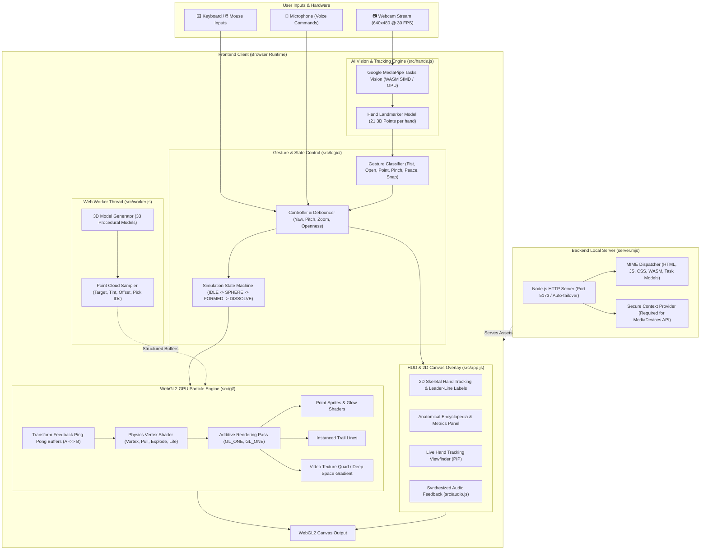

# WonderSnap

**Gesture-controlled 3D models made of glowing light particles, running entirely in your browser.**

Snap your fingers in front of your webcam and up to 250,000 GPU particles swirl into existence. Make a fist and they
form the Eiffel Tower, a beating heart or a V8 engine. Open your hand and the model morphs into the next one, or
explodes into a labelled diagram of every part. No mouse, no controller, no install beyond Node.js.


## Quick start

You need [Node.js](https://nodejs.org/) 18 or newer and a webcam (optional: everything also works with the mouse and
keyboard).

```bash
git clone https://github.com/AkbarSheikh-debug/wondersnap.git
cd wondersnap
npm install
npm start          # Runs HTTP (http://localhost:5173) and HTTPS (https://localhost:5443)
npm run https      # Runs direct HTTPS on port 5173 (https://localhost:5173)
```

Then open **http://localhost:5173** (or **https://localhost:5443**) in Chrome or Edge and click **Start with camera**, or **Continue without camera** to drive it with the on-screen buttons and keyboard.

> The app comes with built-in SSL certificates (`cert.pem`, `key.pem`) for full HTTPS support. When opening `https://` for the first time in Chrome/Edge, click **Advanced** → **Proceed to localhost**. To use a different port: `npm start -- 8080`.

## System Architecture & Structure Map



---

## Architecture Breakdown: Frontend, Backend & Models

### 🖥️ 1. Frontend Architecture
The client application is built with vanilla JavaScript, modern WebGL2, and HTML5 Web APIs, requiring no heavy web frameworks (React/Vue/Three.js):

- **WebGL2 GPU Particle Renderer (`src/gl/renderer.js`, `src/gl/shaders.js`)**:
  - **Transform Feedback**: Particle physics simulation runs completely on GPU ping-pong buffers (`vUpdate[0]` $\leftrightarrow$ `vUpdate[1]`), recalculating up to 100,000+ points at 60 FPS.
  - **Additive Blending**: Point sprites and instanced velocity trails use `gl.blendFunc(gl.ONE, gl.ONE)` for a luminous holographic effect.
  - **Dynamic Exploded View**: Uniform-driven expansion vectors push individual sub-components outward smoothly in 3D based on hand openness.
  - **GPU Driver Recovery**: Native `webglcontextlost` and `webglcontextrestored` event handlers prevent browser freezes and black screens if the graphics driver recovers.

- **Gesture & State Controller (`src/logic/controller.js`, `src/logic/gestures.js`, `src/logic/state.js`)**:
  - Translates raw 3D landmarks into Euler angles, pinch distance, openness percentages, and snap impulses.
  - Manages transitions across 4 scene states: `IDLE` (dormant), `SPHERE` (swirling particle globe), `FORMED` (assembled 3D wonder/organ), and `DISSOLVE`.

- **Off-Screen Web Worker (`src/worker.js`, `src/models/catalog.js`)**:
  - Generates mathematical point clouds off the main UI thread so 60 FPS rendering never stutters during model switches.

- **Audio & Accessibility Engine (`src/audio.js`, `src/features.js`)**:
  - Synthesized Web Audio sound effects for snaps, assembly, and hover states.
  - Web Speech API integration for natural language voice commands and text-to-speech part narration.

---

### ⚙️ 2. Backend Architecture
The backend is a lightweight, zero-dependency Node.js HTTP server (`server.mjs`):

- **Zero-Dependency Core (`server.mjs`)**:
  - Uses native Node.js `node:http`, `node:fs/promises`, and `node:path`.
  - Serves static assets with exact MIME-type headers (including `application/wasm` for WebAssembly binaries and `application/octet-stream` for `.task` neural network weights).

- **Secure Context Provisioning**:
  - The W3C `navigator.mediaDevices.getUserMedia` API strictly mandates a Secure Context (`http://localhost` or HTTPS). The server automatically serves on `http://localhost:5173` to grant camera permissions.

- **Resilient Port Failover**:
  - Listens on port `5173` by default. If the port is in use, it gracefully retries on port `5174+` automatically without crashing.

---

### 🧠 3. AI & Machine Learning Models Used

| Model | File / Source | Size | Engine / Delegate | Purpose |
|---|---|---|---|---|
| **MediaPipe Hand Landmarker** | [`models/hand_landmarker.task`](file:///d:/Real-Time%20Hand%20Gesture-Controlled%203D%20Particle%20Manipulation%20System/models/hand_landmarker.task) | **7.82 MB** | WebAssembly SIMD (`CPU`) or WebGL (`GPU`) | Detects up to 2 hands in real-time, outputting 21 3D Cartesian coordinates `(x, y, z)` for palm, knuckles, and fingertips. Defaults to WASM CPU for rock-solid stability on laptops. |
| **MediaPipe Gesture Recognizer** | [`models/gesture_recognizer.task`](file:///d:/Real-Time%20Hand%20Gesture-Controlled%203D%20Particle%20Manipulation%20System/models/gesture_recognizer.task) | **8.37 MB** | MediaPipe Tasks Vision | Neural network for detecting standard hand poses and gestures with high confidence. |
| **Custom Nearest-Centroid Classifier** | [`models/custom_gesture_weights.json`](file:///d:/Real-Time%20Hand%20Gesture-Controlled%203D%20Particle%20Manipulation%20System/models/custom_gesture_weights.json) | **27.6 KB** | Browser JS Inference | Lightweight 63-feature classifier (21 landmarks $\times$ 3 coordinates, wrist-normalized). Fast nearest-centroid with Z-score bounds. |

---

### 🏛️ 4. 3D Procedural Particle Models (33 Models)

Every model is generated mathematically with physical coordinates, part centroids, and explosion vectors:

| Category | Count | Models Included | Key Interactive Features |
|---|---|---|---|
| **Anatomy** | 10 | Human Body, Beating Heart, Human Brain, Lungs, Skeleton, Kidney, Eye, Ear, Tooth, Skull | Lub-dub heartbeat (72 bpm), 4.5s breathing lungs, organ exploded views, 100+ interactive medical labels with encyclopedia descriptions. |
| **Wonders** | 11 | Turtle Tower, Eiffel Tower, Statue of Liberty, Burj Khalifa, Great Pyramid, Colosseum, Leaning Tower of Pisa, Taj Mahal, Big Ben, Christ the Redeemer, Sydney Opera House | Scaled architectural landmarks, holographic globe lines, smooth morphing between wonders. |
| **Biology** | 2 | DNA Double Helix, Animal Cell | DNA double helix that unzips into individual base pairs; nucleus, mitochondria, and cell organelles. |
| **Engines** | 4 | Supercharged HEMI V8, Inline-4, Turbofan Jet, 9-Cylinder Radial Engine | Moving piston animations, exhaust headers, compressor blades, supercharger blower. |
| **Vehicles** | 4 | Sports Car, Motorcycle, Airliner, Saturn V Rocket | Multi-stage rocket separation (S-IC, S-II, S-IVB, Apollo spacecraft), automotive chassis and engine bay. |
| **Machines** | 2 | Mechanical Wristwatch, EV Battery Pack | Escapement balance wheel, gears, 280 EV battery cells, cooling channels, BMS controllers. |

---

### 📊 5. Datasets & ML Training Pipeline

The project includes training datasets and utilities for fine-tuning custom hand gestures:

- [`gesture_landmarks.csv`](file:///d:/Real-Time%20Hand%20Gesture-Controlled%203D%20Particle%20Manipulation%20System/gesture_landmarks.csv): 366+ pre-recorded landmark frames containing 63 spatial coordinates + labels (`open`, `fist`, `peace`, `point`, `pinch`).
- [`datasets/hand_gestures_dataset.json`](file:///d:/Real-Time%20Hand%20Gesture-Controlled%203D%20Particle%20Manipulation%20System/datasets/hand_gestures_dataset.json): Structured JSON dataset for training hand gesture classifiers.
- [`datasets/human_body_particles.json`](file:///d:/Real-Time%20Hand%20Gesture-Controlled%203D%20Particle%20Manipulation%20System/datasets/human_body_particles.json): Pre-sampled 3D anatomical point cloud points.
- [`datasets/human_heart_cardiac.json`](file:///d:/Real-Time%20Hand%20Gesture-Controlled%203D%20Particle%20Manipulation%20System/datasets/human_heart_cardiac.json): High-density cardiac particle distribution.
- [`scripts/train_hand_gesture_classifier.py`](file:///d:/Real-Time%20Hand%20Gesture-Controlled%203D%20Particle%20Manipulation%20System/scripts/train_hand_gesture_classifier.py): Python script that normalizes coordinates relative to the wrist and generates centroid weights (`custom_gesture_weights.json`).

---

## Gestures

| Gesture | What it does |
|---|---|
| 🫰 **Snap** | Summon the particles, or dissolve the current model |
| ✊ **Fist** | Form the wonder, organ or machine |
| ✋ **Open hand** | Wonders morph to the next one. Organs, engines and vehicles **explode**: how far you open your hand sets how far the parts fly apart, and closing it puts them back together |
| 🔄 **Twist / raise your hand** | Turn and tilt the formed model |
| ☝️ **Point** | Hold your finger on a part to select it. It glows, and a card explains what it does |
| 🤏 **Pinch** | Pull the selected part out toward you; pinch again to put it back |
| 🙌 **Two hands** | Move them apart or together to zoom |
| ✌️ **Peace** | Jump to the next model |

## Keyboard and mouse

| Key | Action |
|---|---|
| `Space` | Snap |
| `F` / `O` / `V` | Fist / open hand / peace sign |
| `←` `→` | Previous / next model |
| `E`, `↑` `↓`, mouse wheel | Explode amount |
| `+` `-` `0`, ctrl + wheel | Zoom |
| `C` | Camera on/off |
| `L` | Part labels |
| `R` | Auto-rotate |
| `G` | Hand rotation on/off |
| `X` | Cut-away cross-section (`,` and `.` nudge the plane) |
| `Q` | Quiz mode |
| `M` | Voice commands and read-aloud |
| `K` | Record a video |
| `D` | Play the demo |
| `I` / `Esc` | Describe / deselect the selected part |
| `H` | Help |

Click a part to select it, drag to rotate.

## Features

- **Beating heart and breathing lungs.** The heart contracts in a lub-dub rhythm at 72 bpm, the lungs inflate every
  4.5 s, and pulses of light travel through them like blood or air.
- **Exploded views with named parts.** Every part has a leader-line label saying what it does.
- **Quiz mode.** "Find: Hippocampus": point at (or click) the right part. Five questions, with a score.
- **Voice control.** Say "show me the heart", "open it up", "where is the right atrium", "zoom in", "quiz" and more.
  Parts are read aloud with speech synthesis (Chrome or Edge).
- **Cut-away.** A cutting plane follows your hand and reveals a glowing cross-section.
- **Recording.** Save a WebM video of the scene.

## Models

| Category | Models |
|---|---|
| **Wonders (11)** | Turtle Tower, Eiffel Tower, Statue of Liberty, Burj Khalifa, Great Pyramid, Colosseum, Leaning Tower of Pisa, Taj Mahal, Big Ben, Christ the Redeemer, Sydney Opera House |
| **Anatomy (10)** | Brain, beating Heart, Kidney, breathing Lungs, Eye, Ear, Tooth, Skull, Skeleton, Human Body (skin, organs, nerves, arteries, veins, skeleton) |
| **Biology (2)** | DNA double helix that unzips, Animal cell |
| **Engines (4)** | Inline-4, Supercharged HEMI V8, Turbofan jet, 9-cylinder radial |
| **Vehicles (4)** | Sports car, Motorcycle, Airliner, Saturn V (with stage separation) |
| **Machines (2)** | Mechanical wristwatch, EV battery pack (280 cells, busbars, cooling, BMS) |

## Gesture sensitivity

The **Gesture sensitivity** control in the status panel defaults to **Standard**, which preserves the original gesture
thresholds. **More forgiving** slightly relaxes static hand-pose recognition and openness. Snap and pinch detection are
unchanged, and the selection lasts only for the current page session.

## URL options

| Option | Effect |
|---|---|
| `?n=250000` | Particle count |
| `?model=12` | Start on a given model |
| `?autostart=camera` / `?autostart=nocamera` | Skip the start screen |
| `?trails=0` | Turn off particle trails |
| `?dpr=1` | Force the device pixel ratio (useful on slower GPUs) |

## Tests

39 end-to-end and unit tests with [Playwright](https://playwright.dev/), driving the real app with synthetic hands on
a deterministic clock.

```bash
npx playwright install chromium   # one time
npm test
```

| Spec | Covers |
|---|---|
| `app.spec.js` | The full gesture story, every model, explode/contract, keyboard, wheel, tabs, demo, phone layout, hand twist and tilt |
| `features.spec.js` | Heartbeat and breathing, two-hand zoom, point-to-pick, pinch-to-pull, quiz, voice commands, cut-away, video recording |
| `camera.spec.js` | Real `getUserMedia` to MediaPipe on Chromium's fake webcam, plus the camera-denied fallback |
| `gpu.spec.js` | The GPU physics shader matches its CPU twin to ~1e-7 in every mode |
| `logic.spec.js` | Pose classifiers, snap detector, debouncer, state machine, controller, voice-command parser |
| `models.spec.js` | Every model is deterministic, finite and fast, with real measurements and correctly exploding parts |

## Project structure

```
index.html, styles.css     page and styles
server.mjs                 zero-dependency static server
models/                    MediaPipe hand landmark model
src/app.js                 render loop, explode, zoom, picking, quiz, cut-away, HUD, labels, demo
src/hands.js               webcam + MediaPipe Hand Landmarker
src/features.js            voice commands, read-aloud, video recorder
src/gl/                    WebGL2 shaders and renderer (transform-feedback physics)
src/logic/                 gestures, state machine, controller, CPU physics twin
src/lib/                   vector math, samplers, procedural shapes
src/models/                wonders, anatomy, biology, engines, vehicles, machines
tests/                     Playwright specs
```

## Troubleshooting

- **Camera doesn't start:** open the app via `http://localhost:5173`, not by double-clicking `index.html`, and allow
  camera access when the browser asks.
- **Hand tracking never loads:** run `npm install` first; the tracking runtime is served from `node_modules`.
- **Low frame rate:** try `http://localhost:5173/?n=100000&dpr=1`.
- **Port already in use:** `npm start -- 8080` and open `http://localhost:8080`.

## License

[MIT](LICENSE) © 2026 Akbar Sheikh
